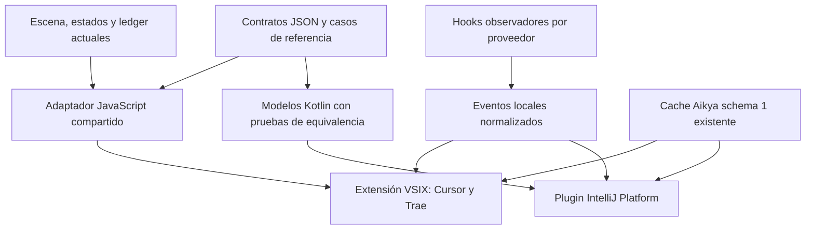

# Aikya Mods: impacto de soporte para Cursor, Trae y JetBrains

> **Alcance corregido el 2026-10-25:** el usuario quiere ejecutar los mods en **Claude Code iniciado desde la terminal integrada** de cada IDE. Las propuestas de VSIX, plugin Kotlin y métricas de agentes propios que siguen se conservan como análisis de una alternativa y quedan fuera del trabajo autorizado actual. Consultar el [plan activo](../../../docs/superpowers/plans/2026-10-25-claude-integrated-terminals.es.md).

Fecha: 2026-10-24. Alcance de este documento: análisis y propuesta; no implementa ni instala las integraciones.

## Resultado

Los tres mods se pueden llevar a estos editores, pero el repositorio actual distribuye exclusivamente plugins de Claude Code. Hay que añadir dos integraciones: una extensión VSIX para Cursor/Trae y un plugin de IntelliJ Platform para JetBrains. La instalación y la interfaz son abordables; la equivalencia de datos de Flow y Usage depende del agente que se observe.

Se interpreta «curso» como Cursor y se asume integración en la interfaz de cada editor. Si el objetivo fuera ejecutar Claude Code en su terminal integrada, se conservaría el instalador actual y bastaría validar esa superficie; eso no integraría los mods en el agente propio del editor.

La propuesta instala un paquete **Aikya Mods** por familia de editor, con BoxBot, Flow y Usage activables por separado. Los tres plugins existentes de Claude conservan su instalación independiente. Separar también los nuevos paquetes por mod multiplicaría distribución y composición; no se propone en la primera entrega.

## Estado comprobado del repositorio

| Elemento | Estado observado | Implicación |
| --- | --- | --- |
| Catálogo | `.claude-plugin/marketplace.json`: BoxBot 0.3.0, Flow 0.1.0, Usage 0.1.0 | Solo Claude reconoce este catálogo |
| Instalación | `install.sh:95` exige `claude`; líneas 104–106 ejecutan `claude plugin ...` | No instala extensiones de los editores |
| Entradas | `mods/*/hooks/hooks.json` declara `modules: ["./register.js"]` | Es un módulo de mods, no un hook de shell importable |
| BoxBot | `lib/scene.js` genera escena, SVG y ASCII; `hooks/register.js` administra panel y reloj de Claude | La escena es reutilizable; el ciclo de vida necesita adaptación |
| Flow | `lib/flow.js` y `lib/snapshot.js` contienen estados, recetas y validación | Reutilizables en JavaScript; acceso a archivos y eventos está en el adaptador de Claude |
| Usage | `lib/usage.js` normaliza métricas y reconcilia tokens; `hooks/register.js:5` usa `$.session.usage()` | No existe una fuente equivalente universal en otros agentes |
| Superficie VS Code | BoxBot y Flow reconocen `e.surface === 'vscode'` | Se refiere a la extensión de **Claude**, no a una extensión independiente para cualquier editor |
| Línea inferior | Usage dibuja `PromptHint` solo en terminal y Desktop (`register.js:65`) | No se puede asumir que ya exista esa línea en Cursor/Trae |
| Pruebas | Incluso las pruebas de lógica importan `claude-code/testing` | Hace falta verificación de contratos fuera de Claude |
| CI | `.github/workflows/ci.yml` ejecuta Python y sintaxis Bash en macOS/Linux | No construye VSIX ni verifica plugins JetBrains |

Comprobaciones ejecutadas durante este análisis: **15/15** pruebas de instaladores; **11/11** de BoxBot; **16/16** de Flow; **12/12** de Usage; sintaxis correcta de los cuatro instaladores. Claude instalado: **2.1.308**. Trae instalado: su ayuda identifica **3.6.4**, y `trae --version` informa una base **1.107.1**. Su CLI documenta `--install-extension`, `--extensions-dir` y `--user-data-dir`. No se probó todavía una extensión propia dentro de Trae, Cursor o JetBrains.

## Capacidades y límites por destino

| Destino | Instalación propuesta | BoxBot | Flow | Usage |
| --- | --- | --- | --- | --- |
| Cursor | VSIX; catálogo de extensiones en una fase posterior | Escena en WebviewView | Hooks documentados para actividad; snapshot Aikya para fases | Contexto puntual en `preCompact`; tokens, coste y cuota solo con una fuente verificada |
| Trae | El mismo VSIX, condicionado a sus APIs compatibles | Escena en WebviewView | Adaptador de hooks según edición y versión; snapshot Aikya para fases | `N/A` donde no se haya verificado una fuente pública |
| JetBrains | ZIP de plugin; después JetBrains Marketplace o repositorio privado | Dibujo Swing en Tool Window | Snapshot Aikya o proveedor conectado; abrir un proyecto no identifica una sesión del agente | Widget de estado; `N/A` sin proveedor de métricas |

Cursor documenta extensiones y hooks de procesos JSON; su importación de hooks de Claude cubre hooks de configuración, no la API JavaScript `register(on)` de estos mods. Su evento `preCompact` incluye una lectura de contexto, pero no representa una medición continua. [Extensiones](https://prod.cursor.com/help/customization/extensions), [hooks](https://cursor.com/docs/hooks), [compatibilidad de hooks](https://prod.cursor.com/docs/reference/third-party-hooks).

TRAE documenta instalación VSIX y advierte sobre diferencias de APIs respecto de VS Code. Los hooks consultados están documentados en la **edición china**; su disponibilidad, nombres y rutas no deben trasladarse automáticamente a la edición internacional instalada. La página internacional de extensiones respondió sin contenido extraíble. [VSIX y compatibilidad](https://docs.trae.cn/ide_manage-extensions), [hooks de TRAE CN](https://docs.trae.cn/ide_hook-configuration-reference), [documentación internacional](https://docs.trae.ai/ide/manage-extensions).

JetBrains ofrece Tool Windows, widgets de estado y una plataforma compartida. Un plugin basado en `com.intellij.modules.platform` puede cubrir varios productos, pero cada combinación debe verificarse. Se recomienda Swing para evitar depender de JCEF y de un motor JavaScript en el equipo del usuario. [Tool Windows](https://plugins.jetbrains.com/docs/intellij/tool-windows.html), [widgets](https://plugins.jetbrains.com/docs/intellij/status-bar-widgets.html), [compatibilidad](https://plugins.jetbrains.com/docs/intellij/plugin-compatibility.html), [recomendación sobre Swing/JCEF](https://plugins.jetbrains.com/docs/intellij/embedded-browser-jcef.html).

**No se ha encontrado en la documentación consultada un contrato único para observar los tokens de los agentes nativos de los tres destinos.** No equivale a demostrar que ninguna API exista: la primera tarea del plan debe comprobar cada versión y registrar sus capacidades. Un servidor MCP, por sí solo, tampoco suministra automáticamente eventos globales del agente ni una superficie de panel del editor.

## Arquitectura propuesta

La lógica JavaScript actual sigue siendo la fuente de las funciones reutilizables. Se empaqueta dentro del VSIX: no habrá imports a rutas del checkout en una instalación final. JetBrains implementa los modelos necesarios en Kotlin y verifica su equivalencia mediante los mismos casos JSON, en lugar de ejecutar JavaScript oculto o exigir Node para dibujar la interfaz.

Los observadores de hooks son opcionales y usan Node 22 o posterior. Reciben JSON por stdin, conservan únicamente campos permitidos y producen eventos locales. No capturan prompts, argumentos completos ni resultados de herramientas. No cambian decisiones, salidas ni permisos del agente. El cliente del editor consume esos eventos y el caché Aikya mediante lectores separados.

La sesión de datos se elige explícitamente por proveedor, raíz canónica y sesión. La clave Aikya sigue siendo `sha256(canonical-project-root + NUL + session-id)`: el ID de ventana del editor no puede sustituir al ID del productor. Sin correlación demostrada se muestra `No evidence`, incluso si hay otros snapshots en el disco.

## Mapa de cambios

| Área / archivos | Cambio previsto | Impacto |
| --- | --- | --- |
| `mods/aikya-boxbot/lib/scene.js` | Reutilizar y empaquetar; no mover en la primera entrega | Bajo |
| `mods/aikya-flow/lib/{flow,snapshot}.js` | Reutilizar y fijar comportamiento con casos compartidos | Medio: identidad y evidencias |
| `mods/aikya-usage/lib/usage.js` | Reutilizar ledger; nuevo formato externo por proveedor | Medio: no propagar etiquetas 5h/7d de Claude a otros proveedores |
| `mods/*/hooks/register.js` y manifiestos actuales | Mantener como adaptadores de Claude; cambios solo si la prueba de capacidades justifica un exportador opcional posterior | Bajo en MVP; alto si se añade exportación |
| `contracts/` — nuevo | Esquemas de eventos, métricas, capacidades y casos de equivalencia JS/Kotlin | Alto: frontera entre implementaciones |
| `integrations/shared/` — nuevo | Estado por sesión, lectores y presentación neutral para la familia VS Code | Alto |
| `integrations/observer/` — nuevo | Normalización de hooks Cursor/Trae y escritura local de eventos | Alto: diferencias entre ediciones y concurrencia |
| `integrations/vscode/` — nuevo | Manifest, activación, WebviewView, comandos y StatusBarItem; un VSIX | Alto |
| `integrations/jetbrains/` — nuevo | Gradle, plugin.xml, modelos Kotlin, Tool Window, animación y widget | Alto; mayor volumen nuevo |
| `install.sh` | Añadir destino explícito y delegación; Claude sigue siendo el valor por defecto | Medio; ruta de instalación existente |
| `mods/*/install.sh` | Seguir delegando y reenviar el destino | Bajo |
| `installers/` — nuevo | Instalación de VSIX; preparación del ZIP e instrucciones JetBrains | Medio |
| `tests/test_installers.py`, `tests/integration_install.py` | Conservar regresiones y añadir destino, artefactos y perfiles aislados | Medio |
| `.github/workflows/ci.yml` y workflow nuevo | Añadir contratos, build VSIX, pruebas Kotlin y Plugin Verifier | Alto en herramientas, separado de CI actual |
| `README.md`, `mods/*/README.md`, `docs/compatibility.md` | Comandos por editor, versiones probadas, capacidades y límites | Medio |
| Núcleo Aikya externo | Ningún cambio en la primera entrega; consume el contrato existente | Dependencia externa para correlación y evidencias |

## Requisitos de la primera entrega

1. Mantener las instalaciones y el comportamiento existentes de Claude Code; interfaz y mensajes de producto en inglés.
2. Entregar un VSIX y un ZIP instalables desde disco, con módulos activables de forma independiente. No publicar en catálogos durante esta fase.
3. Flow arriba y BoxBot debajo en un panel propio; Usage en la barra inferior del editor. La ubicación exacta del panel depende de cada host y de las preferencias del usuario.
4. BoxBot conserva la cinta y las cajas, sin controles dentro del dibujo; acciones en la paleta del editor. Conserva ocho FPS, bucle de ocho segundos y modo inmóvil. Detener el reloj al ocultar, desactivar o cerrar; respetar movimiento reducido cuando el host lo exponga.
5. Flow conserva las seis fases y el criterio de evidencia del schema 1; finalizar una herramienta no completa una fase. El lector comprueba identidad, ejecución activa, revisión y generación.
6. Usage distingue ausencia de datos de cero real. Mantener deduplicación, reconciliación y límites de 256 turnos y 256 pasos por turno donde existan identificadores completos. No sintetizar categorías de caché o IDs que el proveedor no exponga.
7. Cada lectura muestra proveedor, cobertura y momento de observación en sus detalles. Las cuotas son ventanas del proveedor, no necesariamente 5h/7d. Un contexto recibido en `preCompact` se etiqueta como última lectura, no como valor actual continuo.
8. Separar identidad del workspace, sesión del agente y ejecución Aikya. Multi-root requiere elegir raíz; no seleccionar silenciosamente otro proyecto o sesión.
9. Los observadores usan un almacén local elegido por el usuario. Escrituras por evento con archivo temporal y renombrado atómico; máximo 64 KiB por evento y lectura de snapshots limitada a 2.000.000 bytes, como límite actual de Flow. El formato no incluye texto de prompts ni salidas de herramientas.
10. Los lectores consultan como máximo cada dos segundos cuando hay una vista consumidora visible. Descartan resultados pendientes al cambiar de conexión, sesión o proyecto. La recolección y la animación son ciclos separados.
11. Los scripts existentes siguen admitiendo Bash 3.2 en macOS/Linux. `--target claude` es el valor por defecto; nuevos destinos `cursor`, `trae`, `jetbrains`. Mantener `--list`, `--all`, `--dry-run` y validación completa previa a cambios.
12. En nuevos destinos, `--scope user` instala/prepara el paquete del editor; `project` y `local` se rechazan antes de cualquier escritura en el MVP. Esos scopes de Claude no tienen equivalencia directa en la instalación de un plugin del IDE. Los comandos del editor gestionan la activación de cada módulo.
13. `--artifact /ruta/al/paquete` selecciona el VSIX o ZIP ya construido. Los instaladores no compilan ni descargan scripts remotos. Para JetBrains se entrega la ruta y los pasos de instalación desde disco; no se anuncia instalación completa hasta comprobarla dentro del IDE.
14. Toolchain nueva: Node 22 o posterior para build/observadores; Kotlin, Gradle IntelliJ Platform Plugin 2.x y JDK 21 para el baseline JetBrains 2025.3. Verificar también una versión estable 2026.2 con su runtime Java 25. [Requisitos de plataforma](https://plugins.jetbrains.com/docs/intellij/api-changes-list-2025.html).

## Orden, esfuerzo y puertas de salida

| Entrega | Contenido | Esfuerzo relativo | Condición de salida |
| --- | --- | --- | --- |
| 1. Viabilidad | VSIX mínimo en ambos editores, Tool Window en JetBrains, muestra de hooks por versión | Medio | Versiones y capacidades registradas con evidencias |
| 2. Contratos | Fixtures, modelos neutrales, lectura segura y sesiones | Medio | Casos compartidos pasan fuera de Claude |
| 3. Cursor/Trae | BoxBot, Flow, Usage, observador por capacidades | Alto | VSIX instalado y probado en perfiles aislados |
| 4. JetBrains | Modelos Kotlin, panel y widget, lectura del mismo contrato | Alto | Plugin Verifier y revisión manual por producto |
| 5. Distribución | Destinos del instalador, artefactos y documentación | Medio | Instalación individual/conjunta, repetición y fallo probados |
| 6. Paridad de telemetría | Exportador/API oficial del agente cuando exista | Variable | Contexto, tokens y cuotas contrastados con su fuente real |

No se considera conseguida la paridad de Usage por mostrar una barra con `N/A`. La instalación de los tres módulos y la disponibilidad de cada métrica son criterios diferentes que deben figurar en la matriz de publicación. Si se exige paridad total antes de publicar, la entrega queda condicionada a resolver la fuente de telemetría de cada agente.

Matriz objetivo JetBrains: IntelliJ IDEA, PyCharm, WebStorm, GoLand, PhpStorm, CLion, Rider, RubyMine y DataGrip. La matriz final solo marcará como soportadas las combinaciones de producto/versión verificadas. Android Studio y ejecución remota se evalúan aparte; no se deduce su soporte por compartir plataforma. Los paquetes nativos podrán probarse en Windows; no se promete un instalador Bash nativo de Windows.

## Criterios de aceptación

- Las 54 pruebas actuales siguen pasando y se mantienen los cuatro instaladores de Claude.
- El VSIX se instala en Cursor y Trae y el ZIP en los productos JetBrains declarados; cada módulo funciona sin exigir que los otros estén activos.
- Una sesión ajena, un snapshot antiguo, un evento tardío o una métrica ausente nunca se presenta como evidencia o consumo confirmado.
- Cambiar de proyecto, ocultar vistas, recargar y desinstalar liberan lectores y relojes. Eliminar la integración no modifica hooks ajenos.
- La matriz identifica para cada dato su fuente y estado: verificado, no disponible o pendiente de validación.

Plan de ejecución: [2026-10-24-multi-ide.es.md](../../../docs/superpowers/plans/2026-10-24-multi-ide.es.md).

GENERATED BY AIKYA HARNESS
